# ModularMonolithShop

[](https://github.com/example/ModularMonolithShop/actions/workflows/ci.yml)
[](https://dotnet.microsoft.com/)
[](https://docs.microsoft.com/dotnet/csharp/)
[](https://www.postgresql.org/)
[](LICENSE)

A gold-standard, production-quality, interview-ready reference implementation of a **Modular Monolith** built on **.NET 10 LTS (`net10.0`)**, **C# 14**, and **PostgreSQL 17**, featuring Minimal APIs, in-process integration events with transactional outbox and inbox patterns, and automated architecture tests that mechanically enforce module boundaries.

> **Architectural Stance**: For the vast majority of engineering organizations, a disciplined modular monolith is a vastly superior default over microservices. It delivers clear domain boundaries, high cohesion, and independent evolvability without the operational tax of network latency, distributed transactions, partial failures, and complex deployment pipelines. This repository serves as my reference implementation for how to do it properly.

---

## Architecture at a Glance

```mermaid
graph TD
    Client["Client / HTTP / REST (JWT Bearer)"] --> Host["Shop.Host (Single Process)"]

    subgraph Host ["Shop.Host Process Boundary"]
        subgraph CatalogModule ["Catalog Module"]
            CatalogAPI["ICatalogApi (Contracts)"]
            CatalogDomain["Catalog Domain"]
            CatalogOutbox["Catalog Outbox"]
        end

        subgraph InventoryModule ["Inventory Module"]
            InventoryDomain["Inventory Domain"]
            InventoryOutbox["Inventory Outbox"]
            InventoryInbox["Inventory Inbox"]
        end

        subgraph OrderingModule ["Ordering Module"]
            OrderingDomain["Ordering Domain"]
            OrderingOutbox["Ordering Outbox"]
            OrderingInbox["Ordering Inbox"]
        end

        subgraph PaymentsModule ["Payments Module"]
            PaymentsDomain["Payments Domain"]
            PaymentsOutbox["Payments Outbox"]
            PaymentsInbox["Payments Inbox"]
        end

        subgraph NotificationsModule ["Notifications Module"]
            NotificationsDomain["Notifications Domain"]
            NotificationsOutbox["Notifications Outbox"]
            NotificationsInbox["Notifications Inbox"]
        end

        EventTransport["InProcessEventTransport (System.Threading.Channels)"]
    end

    subgraph Database ["PostgreSQL Instance"]
        CatalogSchema[("catalog schema")]
        InventorySchema[("inventory schema")]
        OrderingSchema[("ordering schema")]
        PaymentsSchema[("payments schema")]
        NotificationsSchema[("notifications schema")]
    end

    CatalogDomain --> CatalogSchema
    InventoryDomain --> InventorySchema
    OrderingDomain --> OrderingSchema
    PaymentsDomain --> PaymentsSchema
    NotificationsDomain --> NotificationsSchema

    OrderingDomain -.->|"Sync Query (Read-Only)"| CatalogAPI
    CatalogOutbox --> EventTransport
    InventoryOutbox --> EventTransport
    OrderingOutbox --> EventTransport
    PaymentsOutbox --> EventTransport
    NotificationsOutbox --> EventTransport

    EventTransport --> InventoryInbox
    EventTransport --> OrderingInbox
    EventTransport --> PaymentsInbox
    EventTransport --> NotificationsInbox
```



---

## Key Architectural Tenets

### 1. Assembly-Pair Topology & Strict Visibility
Each of the five modules is structured as a pair of dedicated projects:
- `Shop.Modules.<ModuleName>`: Internal implementation (Domain, Application Use Cases, Infrastructure, DbContext, Endpoints). Every class is `internal` by default; only the module entry point implementing `IModule` is public.
- `Shop.Modules.<ModuleName>.Contracts`: Public contracts (immutable integration event records, read-only query interfaces).

### 2. Multi-Tiered Mechanical Boundary Enforcement
Module isolation is enforced mechanically at four layers:
1. **Project References**: Module implementation assemblies cannot reference other module implementation assemblies.
2. **Compiler Visibility**: C# `internal` visibility prevents type leakage.
3. **Automated Architecture Tests (`tests/Shop.ArchitectureTests`)**: NetArchTest rules (A1–A10) run on every build to verify reference isolation, clean layering, event conventions, and policy authorization.
4. **Database Role Permissions**: Dedicated PostgreSQL application roles (`catalog_app`, `inventory_app`, etc.) have access restricted strictly to their own schema. An automated test asserts that cross-schema queries fail with error `42501` (`insufficient_privilege`), and that zero cross-schema foreign keys exist.

### 3. In-Process Eventing with Transactional Outbox & Inbox
- **Transactional Outbox**: Events are written into an `outbox_messages` table within the same database transaction as the business entity mutation, eliminating dual-write vulnerabilities.
- **`SKIP LOCKED` High-Throughput Polling**: The background `OutboxProcessor` polls using PostgreSQL's `SELECT ... FOR UPDATE SKIP LOCKED` idiom, allowing concurrent workers to process non-overlapping batches without lock contention.
- **Transactional Inbox**: The `InboxDispatcher` guarantees exactly-once processing by checking `(message_id, handler_name)` duplicates before invoking handlers.
- **Trace Propagation**: W3C `TraceParent` distributed trace context is persisted in outbox records and extracted in inbox handlers, providing continuous end-to-end traces across asynchronous hops.

### 4. Choreographed Order Saga with Compensations
The checkout lifecycle spans four modules without a centralized orchestrator:
1. `ordering` accepts the order in `Pending` status and publishes `OrderPlaced`.
2. `inventory` attempts an **atomic conditional stock reservation** (`UPDATE ... WHERE (on_hand - reserved) >= requested`). Publishes `StockReserved` or `StockReservationFailed`.
3. If stock reservation fails, `ordering` cancels the order.
4. If stock is reserved, `payments` authorizes and captures the charge. Publishes `PaymentSucceeded` or `PaymentFailed`.
5. If payment fails, `ordering` cancels the order, which prompts `inventory` to release the reserved stock.
6. If a customer cancels an order while payment is in-flight, `payments` detects the race and issues an automated gateway refund (`PaymentRefunded`).
7. `notifications` asynchronously records email dispatch for confirmed or cancelled orders.

### 5. Production Security Hardening
- **JWT Authentication & Policy Authorization**: ECDSA-signed JWT bearer tokens validated against strongly-typed policies (`shop.customer`, `shop.admin`).
- **Broken Object Level Authorization (BOLA) Defense**: Customer endpoints filter on compound predicates `(order.Id == id && order.CustomerId == currentUserId)`. Accessing a foreign customer's order returns **HTTP 404 Not Found**, never HTTP 403, preventing resource enumeration attacks.
- **Idempotency with SHA-256 Payload Verification**: `POST /api/v1/ordering/orders` requires an `Idempotency-Key` header and validates a SHA-256 hash of the order lines. Cached replays return cached 202; conflicting payloads return `409 Conflict`.
- **Strict Ingress Defense**:
  - Request body size strictly capped at 64 KB (protecting against payload bombing DoS).
  - Strict JSON deserialization with `UnmappedMemberHandling = Disallow` (preventing mass assignment).
  - RFC 7807 ProblemDetails returned for all client errors via `GlobalExceptionHandler`.
  - Rate limiting policies (`read`, `write`, `admin`, `dev-token`).
  - Strict security headers (`X-Content-Type-Options`, `X-Frame-Options`, `Referrer-Policy`, `Content-Security-Policy`, server header stripped).
  - Multi-stage Docker image running as non-root user (`USER $APP_UID`) with read-only root filesystem and dropped capabilities (`cap_drop: ALL`).

---

## Deliberate Non-Goals (Scope Discipline)

To keep this reference implementation pristine, focused, and interview-friendly, the following are deliberate non-goals:
- **No UI**: The system is an API-first backend reference implementation.
- **No External Message Broker**: Events travel over an in-process channel behind `IIntegrationEventTransport`. Extracting any module to Kafka or RabbitMQ requires only swapping the transport implementation.
- **No Real Payment Gateway**: Integrates with an in-memory `FakePaymentGateway` with a deterministic $10,000 threshold for repeatable automated test execution without external API keys.
- **No In-Memory Domain Events Layer**: Use cases persist state and publish integration events to the outbox explicitly, avoiding confusing dual-event layers inside modules.
- **No Distributed Rate Limiting**: Fixed-window in-memory rate limiting is sufficient for a single host deployment.

---

## Quick Start

### Prerequisites
- [.NET 10 SDK (`10.0.100` or later)](https://dotnet.microsoft.com/)
- [Docker Desktop](https://www.docker.com/) (for PostgreSQL and Testcontainers integration tests)

### 1. Run with Docker Compose
The fastest way to spin up the entire production stack (PostgreSQL + Migrations + Host + Aspire Dashboard):
```bash
docker compose up --build
```
- **API Host**: http://localhost:8080
- **Scalar API Reference UI**: http://localhost:8080/scalar/v1
- **OpenAPI v1 Document**: http://localhost:8080/openapi/v1.json
- **Aspire Dashboard (Telemetry & Tracing)**: http://localhost:18888 (start with profile `--profile tools`)

### 2. Run Locally via CLI
Initialize local development secrets and start PostgreSQL:
```bash
# On Linux/macOS
./scripts/init.sh

# Start PostgreSQL via Compose
docker compose up -d postgres

# Run database migrations
dotnet run --project src/Host/Shop.Host -- --migrate

# Seed demo data (optional)
dotnet run --project src/Host/Shop.Host -- --seed-demo

# Launch host process
dotnet run --project src/Host/Shop.Host
```

### 3. Run the Verification Suite
Execute code formatting checks, build with warnings-as-errors, and run all 110+ unit, domain, concurrency, architecture, and integration tests:
```bash
# On Linux/macOS
./scripts/check.sh

# On Windows PowerShell
dotnet test
```

### 4. Interactive HTTP Scratchpad
A ready-to-run [requests.http](file:///d:/Projects/Code/ant/ModularMonolithShop/requests.http) scratchpad is included in the repository root. Open it in VS Code (with REST Client) or Visual Studio to execute the end-to-end checkout saga, test idempotency replays, and inspect tokens.

---

## Integration Event Catalog

| Contract Name | Producer | Consumers | Business Trigger |
| :--- | :--- | :--- | :--- |
| `catalog.product-created.v1` | **Catalog** | **Inventory** | Seeds zero-stock inventory entry. |
| `ordering.order-placed.v1` | **Ordering** | **Inventory**, **Payments** | Kicks off saga; requests stock reservation and tracks payment. |
| `inventory.stock-reserved.v1` | **Inventory** | **Payments**, **Ordering** | Signals atomic stock hold; triggers payment charge. |
| `inventory.stock-reservation-failed.v1` | **Inventory** | **Ordering** | Shortage detected; cancels order. |
| `payments.payment-succeeded.v1` | **Payments** | **Ordering** | Funds captured; confirms order. |
| `payments.payment-failed.v1` | **Payments** | **Ordering** | Charge declined; cancels order and triggers stock release. |
| `payments.payment-refunded.v1` | **Payments** | *(Audit sink)* | Records refund after racing cancellation. |
| `ordering.order-confirmed.v1` | **Ordering** | **Inventory**, **Notifications** | Finalizes saga; commits stock hold and notifies customer. |
| `ordering.order-cancelled.v1` | **Ordering** | **Inventory**, **Payments**, **Notifications** | Compensates saga; releases stock and notifies customer. |
| `notifications.notification-recorded.v1` | **Notifications** | *(Audit sink)* | Confirms customer notification was recorded. |

Detailed JSON schema snapshots and evolution guidelines are documented in [docs/events.md](file:///d:/Projects/Code/ant/ModularMonolithShop/docs/events.md) and [docs/contracts/events/](file:///d:/Projects/Code/ant/ModularMonolithShop/docs/contracts/events/).

---

## Documentation Guide

Comprehensive architectural documentation and design notebooks are located in the `docs/` directory:

- **[Architecture Deep-Dives](file:///d:/Projects/Code/ant/ModularMonolithShop/docs/architecture/)**:
  - [01. Overview](file:///d:/Projects/Code/ant/ModularMonolithShop/docs/architecture/01-overview.md): System architecture and topological structure.
  - [02. Module Boundaries](file:///d:/Projects/Code/ant/ModularMonolithShop/docs/architecture/02-module-boundaries.md): The 4-layer mechanical isolation model.
  - [03. Outbox and Inbox](file:///d:/Projects/Code/ant/ModularMonolithShop/docs/architecture/03-transactional-outbox-inbox.md): Dual-write elimination and `SKIP LOCKED` polling.
  - [04. Order Saga](file:///d:/Projects/Code/ant/ModularMonolithShop/docs/architecture/04-order-saga.md): Distributed choreography and compensation branches.
  - [05. Security and Auth](file:///d:/Projects/Code/ant/ModularMonolithShop/docs/architecture/05-security-and-auth.md): BOLA defense, strict JSON, and authorization matrix.
- **[Module Specifications](file:///d:/Projects/Code/ant/ModularMonolithShop/docs/modules/)**:
  - [Catalog](file:///d:/Projects/Code/ant/ModularMonolithShop/docs/modules/catalog.md), [Inventory](file:///d:/Projects/Code/ant/ModularMonolithShop/docs/modules/inventory.md), [Ordering](file:///d:/Projects/Code/ant/ModularMonolithShop/docs/modules/ordering.md), [Payments](file:///d:/Projects/Code/ant/ModularMonolithShop/docs/modules/payments.md), [Notifications](file:///d:/Projects/Code/ant/ModularMonolithShop/docs/modules/notifications.md).
- **[Architecture Decision Records (ADRs)](file:///d:/Projects/Code/ant/ModularMonolithShop/docs/adr/)**:
  - ADRs 0001 through 0013 detailing every critical design choice and rejected alternative.
- **[Extraction Playbook](file:///d:/Projects/Code/ant/ModularMonolithShop/docs/extraction-playbook.md)**:
  - Step-by-step extraction guide demonstrating how to carve Payments or Catalog into a standalone microservice in under an hour.
- **[Interview Notes](file:///d:/Projects/Code/ant/ModularMonolithShop/docs/INTERVIEW-NOTES.md)**:
  - Technical deep-dive Q&A for senior and principal engineering technical interviews.

---

## License

This project is licensed under the [MIT License](LICENSE).
