# 01. Architectural Overview

## 1. Executive Summary

**ModularMonolithShop** is an architectural reference implementation of a disciplined, production-ready modular monolith built on **.NET 10 LTS (`net10.0`)** and **C# 14**.

The fundamental thesis behind this codebase is:
> **For the vast majority of engineering organizations, a well-factored modular monolith is a vastly superior default over microservices.** It provides clear domain boundaries, independent evolvability, and high velocity without the operational tax of network latency, distributed transactions, partial failures, and complex deployment pipelines.

This repository demonstrates how to enforce module boundaries mechanically, ensuring that if and when business scaling requires extracting a module into an independent service, that extraction can be executed cleanly in hours without rewriting business logic.

---

## 2. System Architecture

```mermaid
graph TD
    Client["Client / Browser / Mobile App"] -->|"HTTP / REST (JWT Bearer)"| Host["Shop.Host (Single Process)"]

    subgraph Host ["Shop.Host Process Boundary"]
        WebMiddleware["Kestrel + Security Headers + Rate Limiter + Global Exception Handler"]
        
        subgraph CatalogModule ["Catalog Module"]
            CatalogAPI["ICatalogApi (Contracts)"]
            CatalogEndpoints["Catalog Endpoints"]
            CatalogDomain["Catalog Domain"]
            CatalogOutbox["Catalog Outbox"]
        end

        subgraph InventoryModule ["Inventory Module"]
            InventoryEndpoints["Inventory Endpoints"]
            InventoryDomain["Inventory Domain"]
            InventoryOutbox["Inventory Outbox"]
            InventoryInbox["Inventory Inbox"]
        end

        subgraph OrderingModule ["Ordering Module"]
            OrderingEndpoints["Ordering Endpoints"]
            OrderingDomain["Ordering Domain"]
            OrderingOutbox["Ordering Outbox"]
            OrderingInbox["Ordering Inbox"]
        end

        subgraph PaymentsModule ["Payments Module"]
            PaymentsEndpoints["Payments Endpoints"]
            PaymentsDomain["Payments Domain"]
            PaymentsOutbox["Payments Outbox"]
            PaymentsInbox["Payments Inbox"]
        end

        subgraph NotificationsModule ["Notifications Module"]
            NotificationsEndpoints["Notifications Endpoints"]
            NotificationsDomain["Notifications Domain"]
            NotificationsOutbox["Notifications Outbox"]
            NotificationsInbox["Notifications Inbox"]
        end

        EventTransport["InProcessEventTransport (System.Threading.Channels)"]
    end

    subgraph Database ["PostgreSQL Instance"]
        CatalogSchema[("catalog schema")]
        InventorySchema[("inventory schema")]
        OrderingSchema[("ordering schema")]
        PaymentsSchema[("payments schema")]
        NotificationsSchema[("notifications schema")]
    end

    CatalogDomain --> CatalogSchema
    InventoryDomain --> InventorySchema
    OrderingDomain --> OrderingSchema
    PaymentsDomain --> PaymentsSchema
    NotificationsDomain --> NotificationsSchema

    OrderingDomain -.->|"Sync Query (Read-Only)"| CatalogAPI
    CatalogOutbox --> EventTransport
    InventoryOutbox --> EventTransport
    OrderingOutbox --> EventTransport
    PaymentsOutbox --> EventTransport
    NotificationsOutbox --> EventTransport

    EventTransport --> InventoryInbox
    EventTransport --> OrderingInbox
    EventTransport --> PaymentsInbox
    EventTransport --> NotificationsInbox
```

---

## 3. Core Architectural Highlights

1. **Assembly Pair Topology**: Each module consists of two projects:
   - `Shop.Modules.<ModuleName>`: Internal implementation (domain, handlers, infrastructure, endpoints).
   - `Shop.Modules.<ModuleName>.Contracts`: Public contracts (integration events, query interfaces).
2. **Mechanical Boundary Enforcement**:
   - Compiler visibility: All implementation types are declared `internal`.
   - Architecture tests: Automated NetArchTest rules verify assembly references, forbidden dependencies, and encapsulation.
   - Database security: Dedicated PostgreSQL app roles with access restricted solely to their own schema. Zero cross-schema foreign keys.
3. **In-Process Integration Eventing**:
   - Transactional outbox pattern using PostgreSQL `FOR UPDATE SKIP LOCKED`.
   - Transactional inbox pattern providing idempotent exactly-once processing guarantees.
   - OpenTelemetry `TraceParent` distributed trace propagation across outbox and inbox hops.
4. **Order Checkout Saga**: Choreographed distributed workflow managing atomic stock reservations, payment authorization, compensations on stock failure or payment decline, and automated racing cancellation refunds.
5. **Security Hardening**:
   - ECDSA-signed JWT bearer tokens with policy-based authorization (`shop.customer`, `shop.admin`).
   - Broken Object Level Authorization (BOLA) protection: queries filter on current customer ID, returning 404 on foreign resources.
   - Strict JSON deserialization (`UnmappedMemberHandling = Disallow`).
   - Strict request body size limit (64 KB).
   - Rate limiting policies (`read`, `write`, `admin`, `dev-token`).
   - Hardened non-root multi-stage Docker container.
