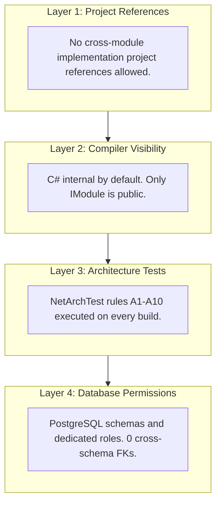

# 02. Module Boundaries and Isolation

## 1. Principles of Isolation

In this modular monolith, module boundaries are treated as first-class physical borders, identical to microservice boundaries. The only difference is that modules execute within the same process.

I enforce module isolation through four independent mechanical layers:

---

## 2. Project Reference Topology

The host project (`Shop.Host`) acts as the composition root, referencing all implementation assemblies to wire them into the ASP.NET Core dependency injection container:

- `Shop.Host` references `Shop.Modules.Catalog`, `Shop.Modules.Inventory`, `Shop.Modules.Ordering`, `Shop.Modules.Payments`, `Shop.Modules.Notifications`.
- `Shop.Modules.Ordering` references `Shop.Modules.Catalog.Contracts`.
- No module implementation project references any other module implementation project!

If a developer attempts to add `<ProjectReference Include="..\Shop.Modules.Inventory\Shop.Modules.Inventory.csproj" />` to `Shop.Modules.Ordering.csproj`, build rule `A1_ModuleImplementations_DoNotReference_OtherModuleImplementations` fails the build immediately.

---

## 3. Architecture Rules Suite (A1 - A10)

These rules are implemented in `tests/Shop.ArchitectureTests`:

| Rule ID | Name | Description |
| :--- | :--- | :--- |
| **A1** | Cross-Module Reference Ban | Module implementation assemblies must not reference other module implementation assemblies. |
| **A2** | Contracts Hygiene | Contracts assemblies may only reference `Shop.BuildingBlocks.Abstractions` and standard BCL libraries (`System.*`). No infrastructure or EF references. |
| **A3** | BuildingBlocks Purity | BuildingBlocks projects cannot reference any module project. |
| **A4** | Public Surface Encapsulation | All types inside a module implementation assembly must be `internal`, except the `IModule` registration class and design-time DbContext factory. |
| **A5** | Clean Layering | Domain must not depend on Application, Infrastructure, or Endpoints. Endpoints must not inject `DbContext`. Handlers must not touch `HttpContext`. |
| **A6** | Integration Event Conformity | Events must be `sealed record`, inherit `IIntegrationEvent`, reside in `*.Contracts.IntegrationEvents.V1`, and carry `[IntegrationEventName]`. |
| **A7** | Event Handler Isolation | Handlers must be `internal sealed`, implement `IIntegrationEventHandler<T>`, and handle only Contracts events. |
| **A8** | DbContext Isolation | DbContexts must be `internal`, inherit `ModuleDbContext`, and default schema must match the module name. |
| **A9** | Extraction Readiness | Handlers must not inject foreign types; only Contracts interfaces may be injected. |
| **A10** | Policy-Based Authorization | Role literals and `[Authorize(Roles = ...)]` are forbidden. Policies only. |
