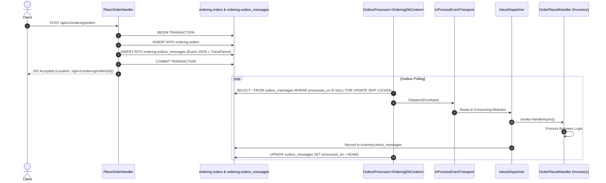

# 03. Transactional Outbox and Inbox Guarantees

## 1. Problem Statement: Dual-Write Vulnerability

When updating state and dispatching events, systems face the dual-write problem:
```
// VULNERABLE DUAL-WRITE
await dbContext.Orders.AddAsync(order);
await dbContext.SaveChangesAsync(); // Step 1: Commit DB
await messageBus.PublishAsync(orderPlaced); // Step 2: Publish Event
```
If the process crashes between Step 1 and Step 2, the order is committed in the database, but downstream modules never receive the event. The distributed workflow halts indefinitely.

## 2. Solution: The Transactional Outbox

I solved this by persisting integration events directly into the module's database inside the **exact same ACID transaction** as the domain state change:



---

## 3. High-Concurrency Polling with `SKIP LOCKED`

In high-throughput environments or when scaling multiple host replicas, naive outbox queries (`SELECT * FROM outbox WHERE processed_on IS NULL`) suffer from lock contention or duplicate message dispatch.

I resolved this using PostgreSQL's row-level locking idiom:
```sql
SELECT id, event_type, payload, trace_parent, attempt_count
FROM catalog.outbox_messages
WHERE processed_on IS NULL 
  AND failed_on IS NULL 
  AND next_attempt_on <= @UtcNow
ORDER BY occurred_on
LIMIT 50
FOR UPDATE SKIP LOCKED;
```

### Guarantees of `SKIP LOCKED`:
- Multiple concurrent workers concurrently read non-overlapping subsets of pending messages.
- Zero thread blocks or deadlocks.
- Messages are processed in temporal order (`ORDER BY occurred_on`).

---

## 4. The Transactional Inbox: Exactly-Once Processing

Network retries or worker restarts can cause at-least-once delivery duplicates. The `InboxDispatcher` ensures exactly-once semantics:

1. When an event envelope arrives, the consumer queries its schema:
   ```sql
   SELECT 1 FROM inventory.inbox_messages 
   WHERE message_id = @EventId AND handler_name = @HandlerName;
   ```
2. If a record exists, the message is skipped immediately as an idempotent duplicate.
3. If new, the handler executes within a database transaction that simultaneously inserts into `inbox_messages`:
   ```sql
   INSERT INTO inventory.inbox_messages (id, message_id, handler_name, received_on, processed_on)
   VALUES (@Id, @MessageId, @HandlerName, @ReceivedOn, @ProcessedOn);
   ```
4. If handler execution throws an exception, the entire transaction rolls back, leaving the inbox empty so the outbox processor can retry after exponential backoff.
