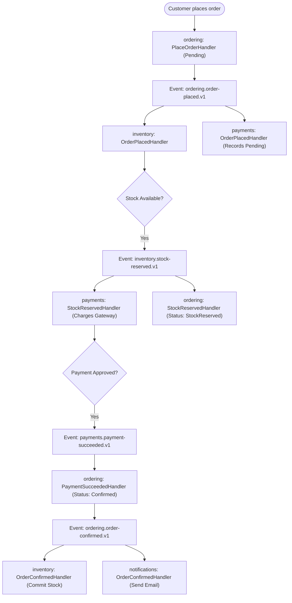
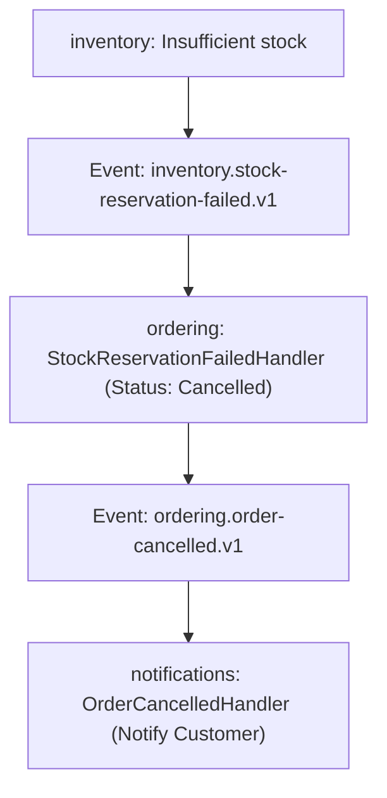
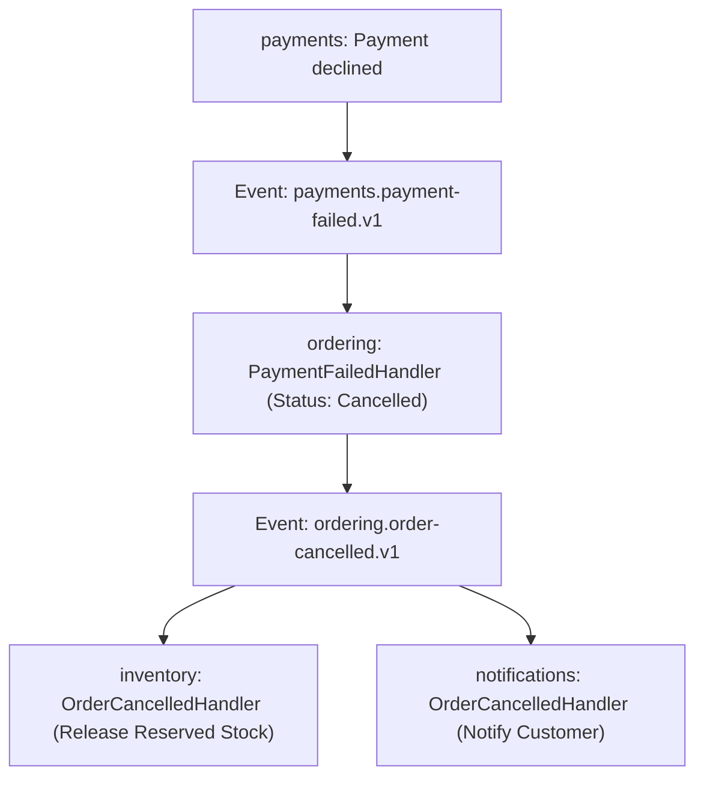
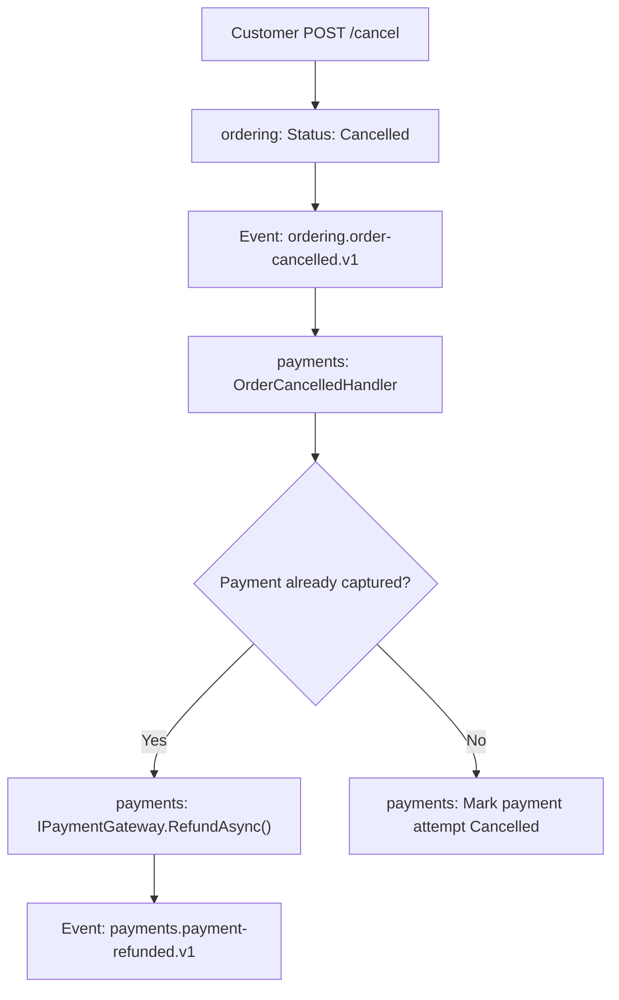

# 04. Order Saga Choreography and Compensations

## 1. The Distributed Saga Lifecycle

The e-commerce order checkout lifecycle spans four modules (`ordering`, `inventory`, `payments`, `notifications`). Because each module has a dedicated PostgreSQL schema and connection pool, cross-module operations are coordinated via an asynchronous saga with explicit compensations.

---

## 2. Happy Path Flowchart

---

## 3. Failure & Compensation Branches

### 3.1 Insufficient Inventory Compensation
When available stock is less than requested:

### 3.2 Payment Decline & Inventory Release
When payment gateway declines authorization (e.g., amount >= $10,000 threshold or card declined):

### 3.3 Racing Customer Cancellation with Automatic Refund
If a customer cancels an order concurrently with payment processing:

---

## 4. Saga Invariants Verified by Automated Integration Tests

In `tests/Shop.IntegrationTests/OrderSagaIntegrationTests.cs`, the test suite verifies:
1. **Happy Path End-to-End**: Order transitions from `Pending` -> `StockReserved` -> `Confirmed`. Stock is committed. Notifications are recorded.
2. **Stock Shortage**: Order transitions to `Cancelled`. Zero stock committed.
3. **Payment Decline Compensation**: Stock is reserved, payment fails, order transitions to `Cancelled`, reserved stock is released back to available inventory.
4. **Racing Cancellation**: Customer cancels before confirmation. Completed payment is automatically refunded.
5. **Idempotent Replay**: Duplicate order submissions return the existing order without re-triggering saga events.
