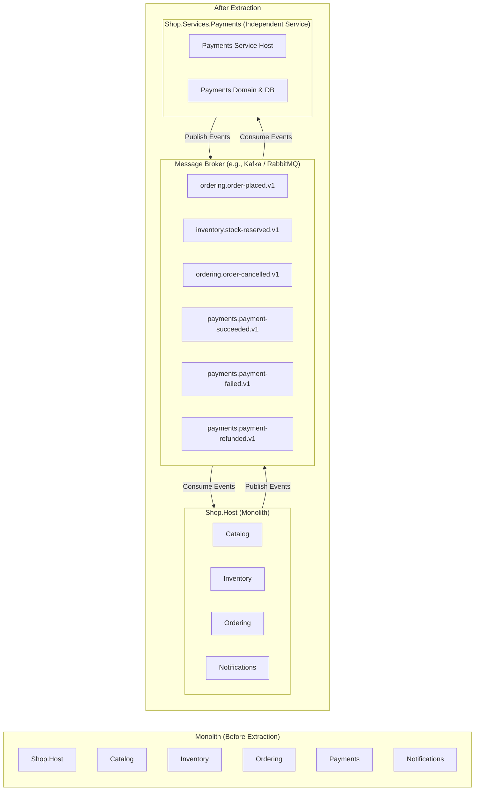

# Microservice Extraction Playbook: Extracting a Module

## 1. Overview and Extraction Philosophy

A central goal of a disciplined modular monolith is **extraction readiness**: the code must be structured so that extracting any module into an independently deployable microservice is a purely mechanical task, requiring zero domain rewrites or database migrations.

This playbook provides a concrete, step-by-step reference for extracting the **Payments** module (or **Catalog** module) into an independent service.

---

## 2. Extraction Scenario: Extracting `Shop.Modules.Payments`



---

## 3. Step-by-Step Extraction Procedure

### Step 1: Database Migration
Because `payments` already resides in its own isolated PostgreSQL schema with zero cross-schema foreign keys or joins, database extraction requires no schema redesign:
1. Export the schema and data:
   ```bash
   pg_dump -h localhost -U shop_migrator -d shop -n payments -F c -f payments_schema.dump
   ```
2. Restore into a new dedicated PostgreSQL database instance:
   ```bash
   pg_restore -h payments-db -U postgres -d payments_service payments_schema.dump
   ```
3. Update connection strings in `appsettings.json` for the new database.

### Step 2: Create the Service Host Project
Create a new ASP.NET Core minimal web API host:
```bash
dotnet new web -n Shop.Services.Payments -o src/Services/Payments/Shop.Services.Payments
```
Add project references to the existing modules:
- Reference `Shop.Modules.Payments.csproj` (the implementation).
- Reference `Shop.Modules.Payments.Contracts.csproj` (its contracts).
- Reference `Shop.BuildingBlocks.Infrastructure.csproj`.

### Step 3: Replace the Event Transport
In the monolith, events flow through `InProcessEventTransport`. In the extracted microservice:
1. Implement `IIntegrationEventTransport` using a message broker client (e.g., RabbitMQ, Apache Kafka, or AWS SQS/SNS).
2. The extracted `Payments` service publishes `PaymentSucceeded`, `PaymentFailed`, and `PaymentRefunded` to broker topics.
3. The extracted service subscribes to `ordering.order-placed.v1`, `inventory.stock-reserved.v1`, and `ordering.order-cancelled.v1`.
4. The remaining monolith host subscribes to `payments.*` topics using the same broker client.
5. **Notice**: The event handlers (`StockReservedIntegrationEventHandler.cs`, etc.) require **zero code changes** because they implement `IIntegrationEventHandler<T>` independently of the underlying transport!

### Step 4: For Modules with Synchronous APIs (e.g., `Catalog`)
If extracting `Catalog` instead of `Payments`, foreign modules (`ordering`) call `ICatalogApi`:
1. In `Shop.Modules.Ordering`, create an implementation of `ICatalogApi` backed by `HttpClient` or gRPC:
   ```csharp
   internal sealed class HttpCatalogApi(HttpClient httpClient) : ICatalogApi
   {
       public async Task<IReadOnlyDictionary<Guid, ProductSnapshot>> GetProductSnapshotsAsync(
           IEnumerable<Guid> productIds, CancellationToken cancellationToken)
       {
           var response = await httpClient.PostAsJsonAsync("/api/v1/catalog/products/snapshots", productIds, cancellationToken);
           return await response.Content.ReadFromJsonAsync<Dictionary<Guid, ProductSnapshot>>(cancellationToken)!;
       }
   }
   ```
2. Replace `services.AddScoped<ICatalogApi, CatalogApi>()` with `services.AddHttpClient<ICatalogApi, HttpCatalogApi>()`.
3. `PlaceOrderHandler` requires **zero code changes** because it depends solely on the `ICatalogApi` abstraction!

### Step 5: Decouple the Monolith Host
In `src/Host/Shop.Host/Shop.Host.csproj`:
1. Remove `<ProjectReference Include="..\..\Modules\Payments\Shop.Modules.Payments\Shop.Modules.Payments.csproj" />`.
2. In `Program.cs`, remove `new PaymentsModule()` from `allModules`.
3. In `compose.yaml`, add the new `Shop.Services.Payments` container.
4. Update the API gateway or reverse proxy (e.g., YARP, NGINX, Envoy) to route `/api/v1/payments/*` traffic to the new container.

---

## 4. Extraction Verification Checklist

- [ ] New database instance operational with schema matching `payments`.
- [ ] Broker producer and consumer subscriptions verified.
- [ ] Monolith builds cleanly with zero references to the extracted implementation assembly.
- [ ] End-to-end integration tests execute against the distributed containers.
- [ ] Outbox message polling drains successfully in both services.
- [ ] OpenTelemetry trace propagation continues seamlessly across the message broker via `TraceParent` headers.
